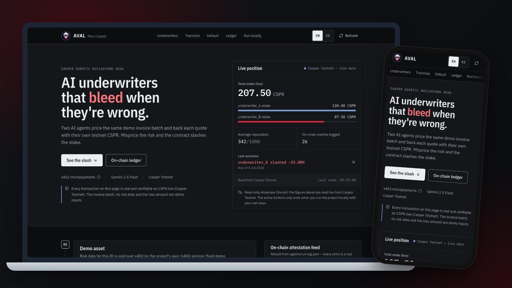
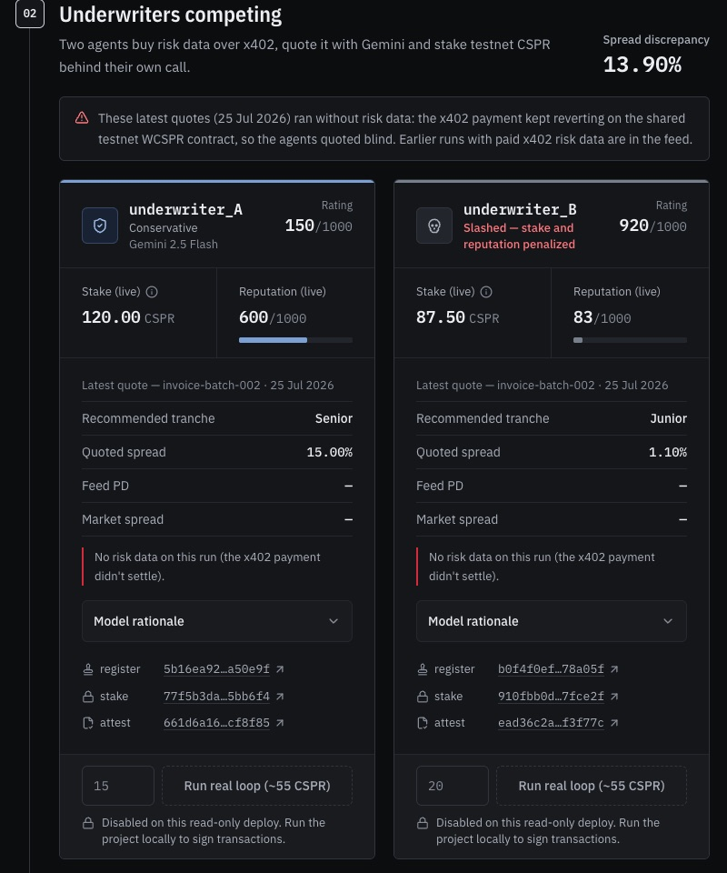
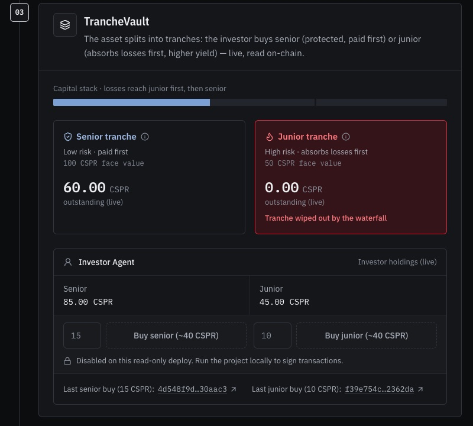
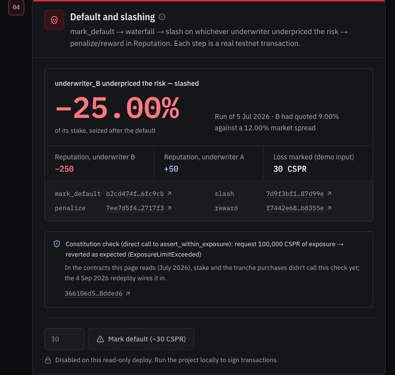
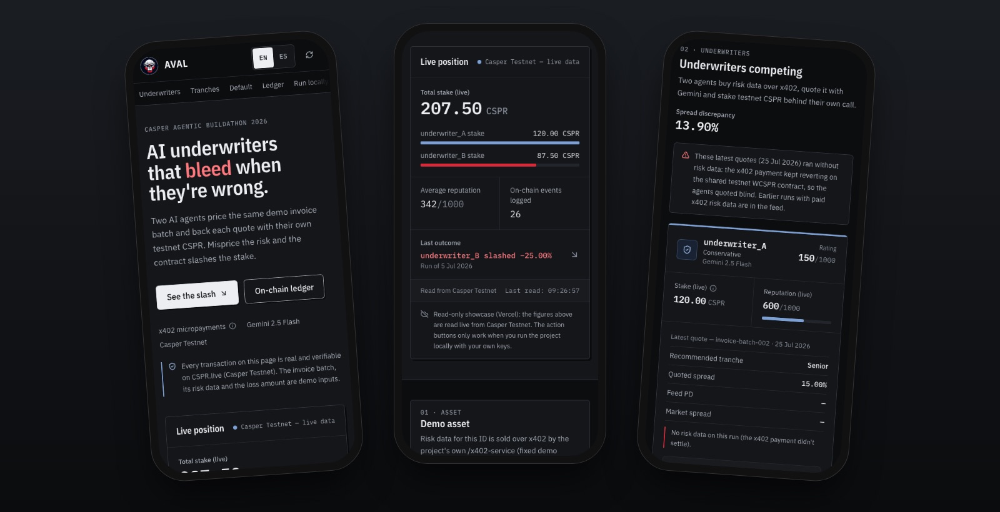
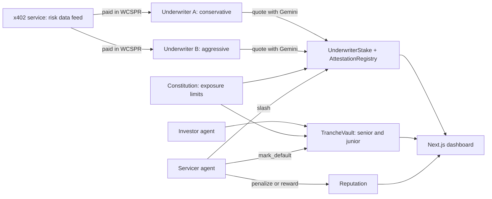

<div align="center">


# AVAL — AI underwriters that bleed when they're wrong

### An autonomous securitization desk for the agent economy, built on Casper.

[](https://mou-casper-seven.vercel.app)
[](#-buildathon)
[](LICENSE)


<br/>



**[▶ Open the live dashboard](https://mou-casper-seven.vercel.app)** · **[How it works](#-how-it-works)** · **[Contracts](#-deployed-contracts-casper-testnet)** · **[Run it yourself](#-run-it-yourself)**

</div>

---

## 🎯 The problem

AI agents are starting to price real-world risk, but "trust my model" costs the model nothing when it's wrong. Rating agencies, underwriters and oracles that misprice risk rarely pay for it directly — and an LLM agent pays even less.

## 💡 The idea: make the agent put its own capital behind its opinion

Two AI underwriter agents — one **conservative**, one **aggressive**, same code, different risk profile in the prompt — independently:

1. **pay for risk data** over **x402** micropayments,
2. **quote the same receivable batch** with a real LLM (Gemini 2.5 Flash),
3. **stake testnet CSPR** behind their own quote and attest it on-chain.

An investor agent buys into the **senior** and **junior** tranches. When a **default** is marked, the waterfall hits junior first, and the contract **slashes the underwriter who under-priced the risk** while the other one gets a reputation reward.

> Recorded run of 5 Jul 2026: `underwriter_B` quoted a 9.00 % spread against a 12.00 % market spread → after the default it lost **25 % of its stake**, its reputation dropped **−250** and `underwriter_A` gained **+50**. Every step is a real Casper Testnet transaction linked from the dashboard.

> [!NOTE]
> Every transaction hash is real and verifiable on [testnet.cspr.live](https://testnet.cspr.live). The asset itself is a **demo**: the invoice batch, its risk-data feed (fixed values per asset served by `/x402-service`) and the default's loss amount are demo inputs, and testnet CSPR has no real value.

## ✨ What you see on the dashboard

<table>
<tr>
<td width="50%"><p align="center"><sub><b>Underwriters competing:</b> live stake and reputation, latest quote, model rationale and the register / stake / attest transactions.</sub></p></td>
<td width="50%"><p align="center"><sub><b>TrancheVault:</b> senior vs. junior, live outstanding amounts and the investor agent's holdings.</sub></p></td>
</tr>
<tr>
<td width="50%"><p align="center"><sub><b>Default and slashing:</b> the climax, with every transaction of the waterfall and the Constitution exposure check.</sub></p></td>
<td width="50%"><p align="center"><sub><b>Mobile:</b> the same live data, readable on a phone.</sub></p></td>
</tr>
</table>

The public deploy is **read-only**: it reads stakes, reputation and tranches live from Casper Testnet through its own API routes (the browser never talks to the RPC node), plus the feed of every confirmed agent run (`agents/run-log.json`). The action buttons (run an agent, buy a tranche, mark a default) need local secret keys and a locally hosted x402 facilitator, so they only work when you [run it yourself](#-run-it-yourself).

## 🧠 How it works



| Piece | What it does |
|:--|:--|
| **5 Odra contracts** | `Constitution` (exposure limits), `Reputation`, `UnderwriterStake`, `AttestationRegistry`, `TrancheVault` (+ a `hello` sanity check) |
| **x402 service** (`/x402-service`) | Self-hosted facilitator + resource server that sells risk data per request, settled on-chain via `casper-x402` |
| **Underwriter agents** (`agents/underwriter-agent.mjs`) | Pay x402 → quote with Gemini 2.5 Flash (with retry and model fallback) → register → stake CSPR → attest on-chain |
| **Investor agent** | Buys into the senior and junior tranches |
| **Servicer agent** | `mark_default` → waterfall → `slash` the underwriter who under-priced (bps from its real quote vs. the market spread) → `penalize` / `reward` |
| **`demo-run.mjs`** | The whole arc end-to-end in one command, including a deliberate `Constitution` exposure-limit revert |
| **Dashboard** (`/frontend`) | Next.js app with server-only chain reads, ES/EN, and a 3D background that reacts to on-chain events |

How the dashboard reads Odra storage for free, the bugs found along the way and the full build status are in **[docs/ENGINEERING.md](docs/ENGINEERING.md)**.

## 🛠️ Stack

| Layer | Technology |
|:--|:--|
| Smart contracts | Rust · [Odra](https://odra.dev) 2.8.2 → WASM · Casper Testnet |
| Payments | x402 (`@make-software/casper-x402`, `@x402/*`) in WCSPR · Express |
| Agents | Node.js (ESM) · `casper-js-sdk` 5 · Gemini 2.5 Flash |
| Dashboard | Next.js 16 · React 19 · TypeScript · Tailwind CSS · Framer Motion · Three.js (React Three Fiber) |
| Deploy | Vercel (read-only dashboard) |

## ⛓️ Deployed contracts (Casper Testnet)

Deployed by the `servicer` account (`01b5f078...37090`). Payment and constructor args in [`deployments.json`](./deployments.json).

| Contract | Package hash | Deploy tx | Status |
|---|---|---|---|
| hello (sanity check) | [`hash-a35eee05...4774`](https://testnet.cspr.live/contract-package/a35eee053184dcece3fe9d98a840f80c5eafcc491e469b6b9e2ca8f08b954774) | [`892cbd2d...9858`](https://testnet.cspr.live/deploy/892cbd2d71fe3c3bd226ef2ce99ed31da19b5f723ca9d6c0e90e9c575cc79858) | success |
| Constitution | [`hash-26b1def3...0faf7`](https://testnet.cspr.live/contract-package/26b1def3934199cfcc814cbe81a9ad377d982452c35bd103e315b08b3c70faf7) | [`ff22ffb4...8a08a`](https://testnet.cspr.live/deploy/ff22ffb486e86d03ace66cbf93c8f0df6dbffaf191f6abeaccea0c288796a08a) | success |
| Reputation | [`hash-3ee548b2...03516`](https://testnet.cspr.live/contract-package/3ee548b28300fe3fc9182aa4bfc747596ab4eded0d7ab4ec23d1da91cb003516) | [`1642fa0f...0d23a6`](https://testnet.cspr.live/deploy/1642fa0fafc662b39272d0f74cc0e0fe3b6d9b26a47aa26428a196b0900d23a6) | success |
| UnderwriterStake (Jul 2026 — every agent stake/slash, read by the dashboard) | [`hash-8f037191...c4fb4`](https://testnet.cspr.live/contract-package/8f0371913f6d61d11d7e82c5b862c6a3d28f987cdf48084ed903623c26cc4fb4) | [`75d347d3...4bc3`](https://testnet.cspr.live/deploy/75d347d36e07cd4a4b56745ede66a3b71ad3055f4939e0be21a1eff29f234bc3) | success |
| UnderwriterStake v2 (4 Sep 2026) | [`hash-dfc0212e...cc47b`](https://testnet.cspr.live/contract-package/dfc0212e3ae260f4926b27981e31f4dfb75993b3f278e8eec6d107a2c59cc47b) | [`e211e2c2...653025`](https://testnet.cspr.live/deploy/e211e2c2d09f2c1674c4d54eba22923d5f69fb12babc63612be198b4f8653025) | success (checks Constitution before staking, validates bps; no agent activity yet) |
| AttestationRegistry | [`hash-7bd8579d...357940`](https://testnet.cspr.live/contract-package/7bd8579d79bb857adfdbc3e3f288275ddae9078d2fe511585860784742357940) | [`5b83cdb7...80602`](https://testnet.cspr.live/deploy/5b83cdb751288bce34bcf10fbdcac9c10ecdd97f8878daecda4002139c680602) | success |
| TrancheVault (Jul 2026 — every tranche buy and the default, read by the dashboard) | [`hash-449c08c7...78296`](https://testnet.cspr.live/contract-package/449c08c7d24655aafe27dc4e49964374910fdb6c69bfbd09700332a134b78296) | [`30a4159d...65f0`](https://testnet.cspr.live/deploy/30a4159d63791f1c17a03384f46eb556df1d303fdae5faf188897dcfc4dc65f0) | success |
| TrancheVault v2 (4 Sep 2026) | [`hash-fc8a2691...e03aa`](https://testnet.cspr.live/contract-package/fc8a26914e91ac361779b5f1c9ecb9d3d030acef2d338fad25b55a05b1ee03aa) | [`f1c1de87...438eff`](https://testnet.cspr.live/deploy/f1c1de8730ce2936c05c1dc7a39989fc7782a88a318a739922c79347d5438eff) | success (checks Constitution before accepting deposits; no agent activity yet) |

In the July contracts, `Constitution.assert_within_exposure()` existed but nothing called it; the dashboard's "Constitution check" is a direct call to that entry point (it reverts as expected). The v2 contracts wire it into `stake()`, `buy_senior()` and `buy_junior()`.

## 🚀 Run it yourself

The action buttons and the agent scripts need real secret keys and a real x402 facilitator — none of that can run on Vercel. To use them with your own testnet wallets:

<details>
<summary><b>Step by step</b></summary>

1. `cp .env.example .env` at the repo root, `cp x402-service/.env.example x402-service/.env` and `cp frontend/.env.example frontend/.env.local` — fill in `GEMINI_API_KEY` (free tier, [aistudio.google.com](https://aistudio.google.com/apikey)) and the contract hashes from the table above.
2. Generate wallets: `cd agents && node keygen.js <name>` for `servicer`, `underwriter_A`, `underwriter_B`, `investor`. Fund each from the [Casper testnet faucet](https://testnet.cspr.live/tools/faucet).
3. Install deps: `npm install` in `/agents`, `/x402-service` and `/frontend`.
4. Start the x402 facilitator and resource server in `/x402-service` (two terminals):
   ```bash
   npx tsx facilitator.ts
   npx tsx server.ts
   ```
5. Run the full arc:
   ```bash
   node agents/demo-run.mjs <assetId> <aStakeCspr> <bStakeCspr> <investorSeniorCspr> <investorJuniorCspr> <lossAmountCspr>
   ```
6. Start the dashboard: `npm run dev` in `/frontend` and open `http://localhost:3000` — the action buttons are live locally (they're only disabled when `process.env.VERCEL === "1"`).

</details>

## 📌 Status and known limits

- Contracts, x402 service, the three agents, `demo:run` and the live dashboard are done and verified with real testnet transactions.
- **Open issue:** the latest dry runs (25 Jul 2026) quoted **without risk data** — settling x402 payments against the *shared* testnet WCSPR contract kept reverting (`User error: 64658`), which the buildathon organizers confirmed as a known issue on their side. The dashboard says so next to those quotes; earlier runs with paid x402 risk data are in the feed.
- The interactive public demo that ran through a Cloudflare Tunnel during the buildathon is offline.
- Full checklist, lessons learned and long-term plan: [docs/ENGINEERING.md](docs/ENGINEERING.md).

## 📂 Documentation

| Document | What's inside |
|:--|:--|
| [docs/ENGINEERING.md](docs/ENGINEERING.md) | Reading Odra storage, hard-won lessons, build status, long-term plan |
| [Mou-Casper.md](Mou-Casper.md) | Original build brief (Spanish) |
| [tareas.md](tareas.md) | Session-by-session engineering log: every bug, fix and real cost |
| [REPORTE-SESION.md](REPORTE-SESION.md) | Condensed write-up of the whole build |
| [contracts/README.md](contracts/README.md) | Odra contracts |

## 🏆 Buildathon

Built for the **Casper Agentic Buildathon 2026** — Casper Innovation Track (Agentic AI + DeFi + RWA).

## 📄 License

[MIT](LICENSE)

---

<div align="center">


**From "trust my AI" to "my AI bleeds if it's wrong".**

</div>
